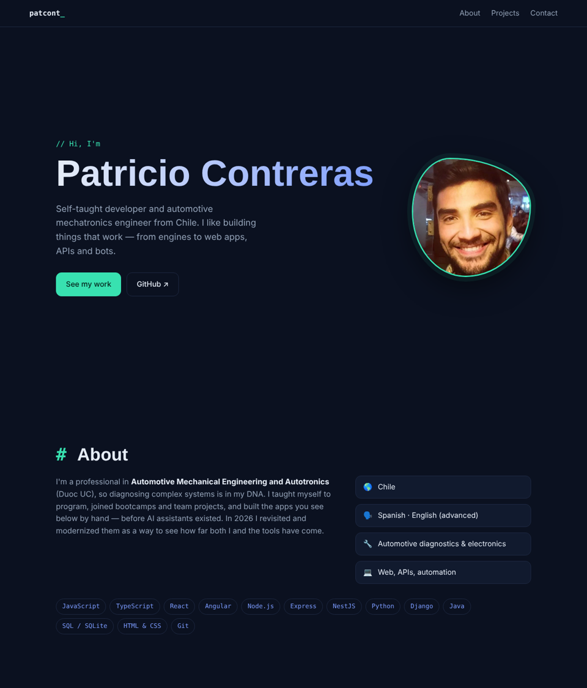

# Patricio Contreras — Portfolio

My personal portfolio: who I am, what I build and how to reach me.

**Live:** https://patcont.github.io/Portfolio-webpage/

## Tech

Hand-written HTML, CSS and a few lines of vanilla JavaScript — no framework, no build step.
Responsive, dark theme, filterable project grid, reveal-on-scroll animations (disabled with *reduced motion*),
Open Graph tags for nice link previews.

## Run it

Open `index.html` or serve the folder (`npx serve .`). Deployed with GitHub Pages from the `main` branch.

## 2026 rebuild

The 2022 site was a BootstrapMade template with ~120 vendor files, nine `portfolio-details copy N.html` pages,
a PHP contact form that can't run on GitHub Pages and ~150 MB of GIFs. It is now a single page of my own
(~170 KB of images in total) that showcases the projects I modernized. The original site is in the git history.
